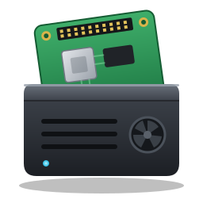

<div align="center">



# Argon Control Center

**A native Linux control center for Raspberry Pi computers in Argon40 cases.**

Monitor the system, tune the fan curve, overclock safely and manage hardware features from one desktop application.

[](https://github.com/wendelmax/argon-control-center/actions/workflows/ci.yml)
[](https://github.com/wendelmax/argon-control-center/actions/workflows/package.yml)
[](https://github.com/wendelmax/argon-control-center/releases)
[](LICENSE)


[Installation](#installation) · [Usage](#usage) · [Documentation](#configuration) · [Changelog](CHANGELOG.md) · [Releases](https://github.com/wendelmax/argon-control-center/releases)

</div>

---

## Table of contents

- [Overview](#overview)
- [Features](#features)
- [Compatibility](#compatibility)
- [Installation](#installation)
- [Usage](#usage)
- [Safe overclocking](#safe-overclocking)
- [Terminal interface](#terminal-interface)
- [Desktop widgets](#desktop-widgets)
- [Configuration](#configuration)
- [Permissions](#permissions)
- [Building from source](#building-from-source)
- [Development](#development)
- [Release process](#release-process)
- [Project structure](#project-structure)
- [Contributing](#contributing)
- [Security](#security)
- [License](#license)

## Overview

Argon Control Center is a desktop application written in Rust with [egui](https://github.com/emilk/egui). It brings together the tasks that are otherwise spread across `config.txt`, the Argon40 scripts, `systemctl` and sysfs:

- live telemetry with history charts;
- a graphical editor for the `argononed` fan curve;
- overclocking presets matched to the detected board;
- hardware toggles for `config.txt`;
- a GPIO logic analyzer and a serial/I2C console.

The board and the Argon case are detected automatically at startup, so presets and limits always match the hardware. The interface follows the desktop color scheme and is available in English and Brazilian Portuguese.

## Features

**Hardware detection**
- Raspberry Pi model, SoC and memory decoded from the board revision code.
- Argon case identified from the installed Argon40 scripts and an I2C scan (fan MCU `0x1a`, OLED `0x3c`, RTC `0x51`, BLSTR DAC `0x4d`).

**Monitoring**
- CPU frequency, governor and per-core load, SoC temperature with peak, fan duty, memory and swap, network throughput, disks and RAID arrays, and the 5 V under-voltage alarm.
- 60-second history charts. Slow probes run on a worker thread so the interface stays responsive.

**GPU**
- V3D load per queue (render, geometry, compute) from the kernel's `gpu_stats`, CMA memory used by the GPU and display, and the GPU clock.
- With firmware access (`vcgencmd`): live GPU / core / H.264 clocks, core voltage, GPU memory split and the throttling flags (under-voltage, capped clock, throttling, soft temperature limit — now and since boot), which also feed the power-supply guard and the stability test.

**Fan control**
- Drag-and-drop curve editor for the CPU (`/etc/argononed.conf`) and disk (`/etc/argononed-hdd.conf`) curves.
- Silent, Standard, Performance and Full Speed profiles, plus an immediate manual override over I2C.

**Overclocking**
- Live changes without rebooting: governor, minimum and maximum frequency, and boost.
- Firmware presets written to a managed block in `config.txt`. The rest of the file is preserved.
- `over_voltage` on Raspberry Pi 3 and 4; `over_voltage_delta` on Raspberry Pi 5.
- Safe overclocking: trial boot, stability test and a power-supply guard (see [Safe overclocking](#safe-overclocking)).

**Hardware features**
- I2C, SPI, I2S, onboard audio, UART, VC4 KMS, camera and display auto-detection.
- Argon BLSTR DAC and IR receiver overlays, OLED settings and EEPROM power-supply limit.

**GPIO and serial lab**
- Live state of the 40-pin header on an annotated pin-out diagram (or a compact list): level, direction, pull and edge counters; click a pin to inspect and drive it.
- Serial monitor for UART and USB adapters, and I2C diagnostic commands.

**Service management**
- Start, stop, restart, enable and disable `argononed.service`, with an explanation of its role before it is stopped.

**Interface**
- Sidebar or top-tab navigation, system or AORUS color scheme, and three dashboard styles, all configurable in Settings.
- Light and dark desktop themes on KDE Plasma, GNOME, Cinnamon, MATE, XFCE and any window manager running xdg-desktop-portal, with enforced text contrast.
- Interface scaling from 80% to 150%; layouts adapt to narrow windows.
- Built-in Help page explaining every feature, with links to the related pages.

**Terminal interface**
- When there is no graphical session (for example over SSH) the application opens a read-only, btop-style terminal interface: cpu, mem, net, gpu and argon boxes with gradient meters and history graphs. See [Terminal interface](#terminal-interface).

**Desktop widgets (KDE Plasma 6)**
- Eight widgets — CPU, Thermal, GPU, Memory, Network, Storage, Power and System — to place on the desktop or in a panel.
- Each metric widget offers three styles: bars, gauges (transparent background, sized to the widget) or a two-minute chart. See [Desktop widgets](#desktop-widgets).

## Compatibility

### Boards and overclocking profiles

| Board | SoC | Eco | Stock | OC | Extreme |
|---|---|---|---|---|---|
| Raspberry Pi 5, 500, CM5 | BCM2712 | 1800 MHz | 2400 MHz | 2800 MHz | 3000 MHz |
| Raspberry Pi 4, 400, CM4 | BCM2711 | 1500 MHz | 1800 MHz | 2000 MHz | 2147 MHz |
| Raspberry Pi 3, Zero 2 W | BCM2837 | 1000 MHz | 1400 MHz | 1450 MHz | 1500 MHz |

Packages target 64-bit Raspberry Pi systems. Building from source on other Linux machines works for development; the monitoring features run there and Raspberry Pi specific features are disabled.

### Argon40 cases

| Case | Board |
|---|---|
| Argon ONE, Argon ONE M.2 | Raspberry Pi 4 |
| Argon ONE V3, Argon ONE V3 M.2 | Raspberry Pi 5 |
| Argon EON | Raspberry Pi 4 |

A case is optional. Without one, fan control has no effect and everything else works.

### Distributions

Packaged for Debian, Ubuntu, Raspberry Pi OS, Armbian, Fedora and Arch Linux. Requires a Wayland or X11 session with OpenGL.

## Installation

### Packages

Download the package for your distribution from the [latest release](https://github.com/wendelmax/argon-control-center/releases/latest). Packages are built for 64-bit ARM (Raspberry Pi 3, 4, 5 with a 64-bit OS).

| Distribution | Command |
|---|---|
| Debian, Ubuntu, Raspberry Pi OS, Armbian | `sudo apt install ./argon-control-center_<version>_arm64.deb` |
| Fedora | `sudo dnf install ./argon-control-center-<version>-1.<dist>.aarch64.rpm` |
| Arch Linux ARM | `sudo pacman -U ./argon-control-center-<version>-1-aarch64.pkg.tar.zst` |

The packages install the application, its menu entry and the hardware access rules (see [Permissions](#permissions)). Log out and back in once after installing.

Verify a download with:

```sh
sha256sum --check --ignore-missing SHA256SUMS
```

### Argon40 daemon (recommended)

Fan curves, the power button and the OLED display are handled by the official `argononed` service:

```sh
curl https://download.argon40.com/argon1.sh | bash      # Argon ONE (Pi 4) and ONE V3 (Pi 5)
curl https://download.argon40.com/argoneon.sh | bash    # Argon EON
```

## Usage

Launch **Argon Control Center** from the application menu, or run:

```sh
argon-control-center
```

| Option | Description |
|---|---|
| `--gui` | Open the graphical interface even when no display is detected |
| `--tui` | Open the terminal interface even inside a graphical session |
| `--status`, `-s` | Print telemetry, detected hardware, power events and the current overclock, then exit |
| `--json` | Print a one-line JSON snapshot (CPU, temperature, fan, memory, disks, network, GPU, power flags, system) for scripts and widgets |
| `--doctor` | Report which hardware interfaces and tools are available to the current user, and how to enable the missing ones |
| `--stress <seconds>` | Run the stability test without the interface; exits with status 1 if the result is not stable |
| `--pt`, `--lang=pt` | Start in Brazilian Portuguese |
| `--en`, `--lang=en` | Start in English |

Example:

```text
$ argon-control-center --status
=== ARGON CONTROL CENTER — TELEMETRY ===
Board         : Raspberry Pi 4 Model B Rev 1.4
Detected      : Pi 4 · BCM2711 · 8 GB · Argon ONE (Pi 4)
CPU Temp      : 47.7 °C | Target Fan: 0% | Argononed: active
```

## Safe overclocking

A firmware overclock that the board or power supply cannot sustain usually shows up as a system that no longer boots. The application guards against this in three ways.

**Power-supply guard.** The 5 V rail is monitored through the `rpi_volt` sensor and the kernel log. If under-voltage has occurred since boot, settings above factory clocks are blocked, because a supply that already dips at stock clocks cannot sustain an overclock. Use the official 5.1 V / 3 A supply (or the one recommended for your Argon case) and reboot.

**Trial boot.** On boards with the tryboot bootloader feature (Raspberry Pi 4 with a recent EEPROM, Raspberry Pi 5), settings above factory clocks are not written to `config.txt`. They go to `tryboot.txt`, and the board boots once with them:

1. **Test boot** writes `tryboot.txt`; nothing changes yet.
2. **Reboot into trial** starts the board once with the new settings.
3. If the board hangs, switch it off and on: it boots the unchanged `config.txt`, and the application reports that the trial failed.
4. If it boots, run the stability test. **Keep** copies the settings to `config.txt` once the test is stable; **Discard** removes them.

On boards without tryboot, saving above factory clocks requires explicitly accepting the risk.

**Stability test.** Loads every core for 1, 3 or 10 minutes while recording temperature, clock and the 5 V rail, then reports one of: stable, throttled, too hot (80 °C) or under-voltage. Progress is saved every second, so if the system freezes during the test the result is reported after the next start. The same test is available from the command line:

```sh
argon-control-center --stress 180
```

Each page saves only its own settings: saving hardware interfaces never writes overclock values, and saving an overclock never changes interfaces.

## Terminal interface

Without a graphical session (neither `WAYLAND_DISPLAY` nor `DISPLAY` set) and when started from a terminal, `argon-control-center` opens a terminal interface instead of the window — useful over SSH or on a Pi without a desktop. Use `--tui` to open it inside a desktop session, or `--gui` to force the window.

```text
╭ cpu ──────────────────────────────╮╭ mem ──────────────────────────────╮
│total  ■■■■■■■■■■············  8.2% ││mem    ■■■■■■■■·········· 2.1/7.6G │
│cpu0   ■■■■··················  3.1% ││swap   ■················· 271/3902M│
│clock  1800 MHz  ondemand          ││/      ■■················  16/226G │
│ ▁▃▅▆██▁▂▄▆▇█▂▄▅▇█▁▃▅▆██           │╰───────────────────────────────────╯
╰───────────────────────────────────╯╭ argon ────────────────────────────╮
                                     │temp   ■■■■■■■■■■■·······  53.6 °C │
                                     │5V     OK                          │
                                     ╰───────────────────────────────────╯
 Pi 4 · BCM2711 · 8 GB · Argon ONE (Pi 4) · up 4h 12m · load 0.52   q quit · ? help
```

It is read-only and refreshes every second; meters are filled from left to right (0 to 100 %) with a green, amber and red gradient. Press `q` or `Esc` to quit and `?` for help. Use the graphical interface to change settings.

The command-line reference is available as a manual page: `man argon-control-center`.

## Desktop widgets

On KDE Plasma 6, right-click the desktop or a panel, choose **Add Widgets** and search for **Argon**.

| Widget | Shows | Styles |
|---|---|---|
| Argon CPU | total and per-core load, clock, governor | bars, gauges, chart |
| Argon Thermal | SoC temperature, fan duty | bars, gauges, chart |
| Argon GPU | render and geometry load, CMA memory, GPU clock | bars, gauges, chart |
| Argon Memory | RAM and swap | bars, gauges, chart |
| Argon Network | download and upload | bars, gauges, chart |
| Argon Storage | usage of each mounted disk | bars, gauges |
| Argon Power | 5 V supply, firmware throttling flags, argononed | status |
| Argon System | board, OS, kernel, uptime, load | status |

Choose the style in the widget's **Configure** dialog. The gauges style has a transparent background and sizes its gauges to the widget; the chart keeps the last two minutes. In a panel each widget shows a compact value, and clicking a widget opens the application.

The widgets read `argon-control-center --json` every two seconds; rates are computed against the previous reading, so each call takes a few milliseconds. The packages install them system-wide; `scripts/install.sh` installs them for the current user.

## Configuration

Preferences are changed on the **Settings** page and stored in `~/.config/argon-control-center/settings.json`.

| Setting | Options |
|---|---|
| Navigation | Sidebar, Top tabs |
| Colors | Follow system, AORUS |
| Dashboard | Compact, Charts, Gauges |
| Interface scale | 80% to 150% |
| Language | English, Português (Brasil) |
| Temperature unit | °C, °F (the case OLED unit is applied separately) |

System files written by the application:

| File | Purpose |
|---|---|
| `/boot/firmware/config.txt` (or `/boot/config.txt`) | Overclocking and hardware overlays |
| `/boot/firmware/tryboot.txt` | Overclock under trial (used for a single boot) |
| `/etc/argononed.conf`, `/etc/argononed-hdd.conf` | Fan curves |
| `/etc/argonunits.conf` | Temperature unit used by `argononed` and the OLED |
| `/etc/argoneonoled.conf` | OLED display settings |

Every write goes through Polkit, replaces the file atomically and keeps the previous version as `<file>.argoncc.bak`.

## Permissions

The application never needs to run as root. Privileged writes prompt for a password through Polkit. Direct hardware access uses group membership:

| Feature | Requirement |
|---|---|
| Telemetry | None |
| System files, service control | Polkit authentication when needed |
| I2C (case detection, fan override, console) | `i2c` group |
| GPIO lab | `gpio` group |
| Serial console | `dialout` (Debian, Fedora) or `uucp` (Arch) |
| GPU / core clocks, throttling flags (`vcgencmd`) | `video` group (`/dev/vcio`) and `vcgencmd` installed |

The packages create the groups, install udev rules for `/dev/i2c-*`, `/dev/gpiochip*`, `/dev/gpiomem*` and `/dev/vcio` (the firmware mailbox, with the same permissions as Raspberry Pi OS), load `i2c-dev` at boot, and print which optional tools are present. The user who installed the package with `sudo` is added to the groups automatically.

For installations from source, use **Unlock Direct Hardware Access** in the GPIO lab, or run:

```sh
sudo packaging/common/setup-permissions.sh "$USER"
```

No setuid binaries or world-writable device nodes are used. Run `argon-control-center --doctor` (or open Settings > About) to see what is available to your user.

## Building from source

### Dependencies

```sh
# Debian / Ubuntu / Raspberry Pi OS
sudo apt install build-essential pkg-config libgl1-mesa-dev libxkbcommon-dev \
  libwayland-dev libx11-dev libxcursor-dev libxrandr-dev libxi-dev

# Fedora
sudo dnf install gcc pkgconf mesa-libGL-devel mesa-libEGL-devel \
  libxkbcommon-devel wayland-devel libX11-devel

# Arch Linux
sudo pacman -S --needed base-devel libglvnd libxkbcommon wayland libx11
```

Rust stable is required. The toolchain is pinned with [mise](https://mise.jdx.dev) (`mise.toml`); [rustup](https://rustup.rs) also works.

Optional runtime tools: `pkexec` (Polkit), `i2c-tools`, `gpiod` / `libgpiod-utils` and `pinctrl` (`raspi-utils` on Raspberry Pi OS).

### Build and install

```sh
git clone https://github.com/wendelmax/argon-control-center.git
cd argon-control-center
mise install          # install the pinned Rust toolchain
mise run install      # build and install to ~/.local
```

Without mise, use `cargo build --release` and `scripts/install.sh`. Remove the installation with `mise run uninstall` or `scripts/install.sh --uninstall`.

### Packages

```sh
packaging/debian/build-deb.sh                          # Debian / Ubuntu  -> dist/*.deb
rpmbuild -bb packaging/rpm/argon-control-center.spec   # Fedora (source tarball in ~/rpmbuild/SOURCES)
(cd packaging/arch && makepkg -si)                     # Arch Linux
```

## Development

```sh
mise run check     # tests
mise run lint      # rustfmt check and clippy with warnings as errors
cargo run          # run the application

cargo test print_board -- --ignored --nocapture     # print detected hardware
cargo test print_detected -- --ignored --nocapture  # print detected desktop colors
```

Continuous integration runs formatting, clippy, tests and a release build on ARM64 (the Raspberry Pi architecture) for every pull request. Changes to packaging also build, install and test the Debian, Fedora and Arch packages.

Commit messages follow [Conventional Commits](https://www.conventionalcommits.org/) (`feat:`, `fix:`, `chore:`, `ci:`).

## Release process

Versions follow [Semantic Versioning](https://semver.org/): increment **MAJOR** for breaking changes, **MINOR** for new features and **PATCH** for fixes.

1. Record changes under `[Unreleased]` in [CHANGELOG.md](CHANGELOG.md).
2. Bump the version on a branch and merge it through a pull request:
   ```sh
   scripts/bump-version.sh patch    # or: minor, major
   ```
   This updates `Cargo.toml`, `Cargo.lock`, the RPM spec, the PKGBUILD and the changelog.
3. Tag the merged commit on `main` and push the tag:
   ```sh
   scripts/bump-version.sh --tag
   git push origin vX.Y.Z
   ```

Pushing the tag builds and tests every package and publishes a GitHub Release named "Argon Control Center X.Y.Z". The release notes come from the changelog and include installation instructions and checksums. Tags with a pre-release suffix such as `v1.2.0-rc.1` are published as pre-releases. Preview the notes with `scripts/release-notes.sh vX.Y.Z`.

## Project structure

```text
src/
  main.rs            entry point and command-line options
  ui.rs              application window, pages and layouts
  board.rs           board, case and overclocking profile detection
  telemetry.rs       sensors from /proc and /sys
  argon.rs           fan curves and Argon MCU access
  overclock.rs       config.txt parsing and writing, live cpufreq
  gpio_lab.rs        GPIO analyzer, serial and I2C console, permission setup
  theme.rs           styles, charts and theme-aware colors
  system_colors.rs   desktop color scheme detection
  settings.rs        user preferences
  i18n.rs            English and Portuguese strings
  privileged.rs      Polkit elevation and atomic writes
  gpu.rs             V3D load, CMA memory and firmware values (vcgencmd)
  doctor.rs          hardware access self-check
  snapshot.rs        one-shot JSON snapshot (--json) for widgets and scripts
  help.rs            in-app help content (English and Portuguese)
  tui.rs             terminal interface (ratatui)
  pinout.rs          GPIO pin-out diagram rendering and pin positions
  power.rs           5 V supply monitoring
  stability.rs       CPU stability test
  tryboot.rs         trial boot for firmware overclocking
assets/              pin-out diagram and asset credits
docs/                manual page (argon-control-center.1)
packaging/           Debian, RPM and Arch packaging, udev rules, permission setup
  plasma/            Plasma 6 widgets; shared components in common/, assembled by stage.sh
scripts/             install, version bump and release notes helpers
.github/workflows/   CI and package/release pipelines
```

## Contributing

Contributions are welcome. Please open an issue to discuss larger changes first.

1. Fork the repository and create a branch from `main`.
2. Make your change and add tests where practical.
3. Run `mise run lint` and `mise run check`.
4. Add an entry under `[Unreleased]` in `CHANGELOG.md`.
5. Open a pull request with a Conventional Commit title.

## Security

Overclocking and over-voltage settings can make a system unstable. Use the trial boot, keep active cooling in place and fix any under-voltage first. If a board no longer boots after a permanent change, edit `config.txt` on the boot media from another computer: restore `config.txt.argoncc.bak` or remove the `ARGON CONTROL CENTER` block.

Stopping `argononed` disables the automatic fan curve and the case power button.

To report a security issue, please use [GitHub private vulnerability reporting](https://github.com/wendelmax/argon-control-center/security/advisories/new) instead of a public issue.

## License

Released under the [MIT License](LICENSE).

The GPIO pin-out diagram (`assets/gpio.svg`) is by Dirk Koudstaal (element14) and is licensed under Creative Commons Attribution-ShareAlike; see [assets/CREDITS.md](assets/CREDITS.md).

Argon40, Raspberry Pi and AORUS are trademarks of their respective owners. This project is not affiliated with or endorsed by them.
